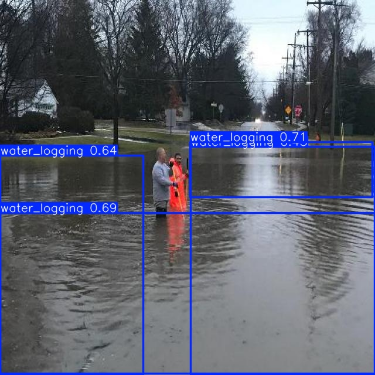
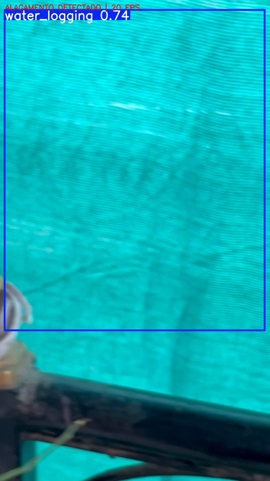

# AlertaBairro · Visão Computacional

Detecção de alagamentos em vias urbanas com **YOLO11**, componente de visão computacional da plataforma **AlertaBairro**.

**FIAP · Global Solution 2026.2 · CitizenTech**
Disciplina: Applied Computer Vision · Professores: Arnaldo Viana e Paulo Rodrigues

## Integrantes

| Nome completo | RM |
|---|---|
| Victor Camargo Maciel | 98384 |
| Geovanna Silva Cunha | 97736 |
| Pedro Emereci Gava | 551043 |
| Bianca Carvalho Dancs Firsoff | 551645 |

## Links

- 🎥 **Vídeo de demonstração:** (https://youtu.be/3Zbm2bE0Azc)
- 📄 **Relatório técnico:** [docs/AlertaBairro_Visao_Computacional.pdf](docs/AlertaBairro_Visao_Computacional.pdf)
- 📓 **Notebook de treino:** [alertabairro_visao_treino_v1.ipynb](alertabairro_visao_treino_v1.ipynb)

## O problema

Em dias de chuva forte, ruas de São Paulo alagam em minutos. No AlertaBairro, os moradores relatam alagamentos com fotos, e cada foto precisa ser verificada antes de aparecer no mapa para outros moradores. Revisar tudo manualmente não escala justamente nos dias de temporal.

Este componente verifica a foto automaticamente: se o modelo detecta água acumulada na via, o relato recebe o selo **verificado por imagem**. Se não detecta, o relato segue para revisão humana. O modelo apoia a moderação, mas não a substitui, nem substitui os alertas oficiais da Defesa Civil.

## Como funciona

```
Morador envia foto → API do AlertaBairro (FastAPI) → YOLO11n → "alagamento confirmado" ou revisão humana
```

## Dataset

- **Fonte:** [water logging (CityOps)](https://universe.roboflow.com/cityops/water-logging-go16i), no Roboflow Universe, com licença **CC BY 4.0**
- **Classe:** `water_logging`
- **Imagens:** 199 originais, todas tiradas ao nível da rua

| Conjunto | Originais | Após augmentation |
|---|---|---|
| Treino | 145 | 435 |
| Validação | 39 | 39 |
| Teste | 15 | 15 |

- **Pré-processamento:** auto-orient e redimensionamento para 640×640
- **Augmentation (só no treino, 3x):** espelhamento horizontal, brilho de ±25% e desfoque de até 1 px

## Resultados

| Métrica | v1 · YOLO11n ✅ | v2 · YOLO11s |
|---|---|---|
| mAP50 | 0,275 | 0,288 |
| mAP50-95 | 0,133 | 0,137 |
| Precisão | 0,427 | 0,399 |
| Recall | 0,291 | 0,314 |
| Acerto por imagem (validação) | **22/39 (56%)** | 17/39 (44%) |
| Acerto por imagem (teste) | 8/15 (53%) | 8/15 (53%) |
| Parâmetros | **2,6 mi** | 9,4 mi |

**Modelo escolhido: YOLO11n.** O YOLO11s, 3,6 vezes maior, não trouxe ganho prático.

**Tempo real:** 18,2 FPS em vídeo (GPU T4), com alagamento sinalizado em 92% dos quadros.

| Detecção correta | Falso positivo |
|---|---|
|  |  |
| Água acumulada detectada em imagem de validação | Tela de sombreamento turquesa confundida com água |

Curvas de treino: [resultados/results.png](resultados/results.png) · Matriz de confusão: [resultados/confusion_matrix.png](resultados/confusion_matrix.png)

### Principais conclusões

- **O limite está nos dados, e não no modelo.** Um modelo maior não melhorou o acerto por imagem.
- **O mAP é baixo porque a água não tem forma definida:** o modelo encontra a água, mas recorta em caixas diferentes das anotadas.
- **Faltam exemplos negativos:** sem imagens de ruas secas no treino, o modelo confunde superfícies parecidas com água.
- **Próximos passos:** fotos de ruas de São Paulo, imagens negativas, segmentação (YOLO11-seg) e borrar rostos e placas, por causa da LGPD.

## Como reproduzir

### Treino (Google Colab)

1. Abra o [notebook](alertabairro_visao_treino_v1.ipynb) no Colab e selecione **GPU T4**.
2. Em 🔑 **Secrets**, crie `ROBOFLOW_API_KEY` com a sua chave do Roboflow. A chave nunca fica no código.
3. Na célula de configuração, preencha `WORKSPACE`, `PROJECT` e `VERSION` com a versão do dataset no seu workspace.
4. Rode **Executar tudo**. O treino usa `seed=42` para ser reproduzível.

### Inferência local

```bash
pip install -r requirements.txt

# Verificar uma foto (retorna JSON)
python scripts/verificar_foto.py --foto minha_foto.jpg

# Demo em vídeo
python scripts/demo_video.py --video rua_alagada.mp4 --saida rua_alagada_detectado.mp4
```

Exemplo de saída do `verificar_foto.py`:

```json
{
  "alagamento_confirmado": true,
  "regioes_detectadas": 3,
  "confianca_maxima": 0.71,
  "limiar": 0.5
}
```

## Estrutura

```
alertabairro-visao/
├── alertabairro_visao_treino_v1.ipynb   notebook de treino com as saídas
├── modelo/      pesos treinados (alertabairro_v1.pt)
├── scripts/     verificação de foto e demo em vídeo
├── resultados/  curvas, matriz de confusão e exemplos
├── docs/        relatório técnico em PDF
└── requirements.txt
```

## Créditos

Dataset: CityOps, *water logging*, Roboflow Universe, licença CC BY 4.0. Modelo: [Ultralytics YOLO11](https://github.com/ultralytics/ultralytics).
